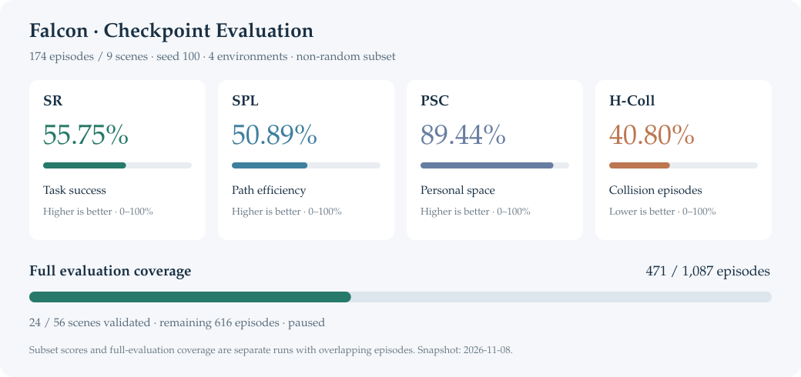
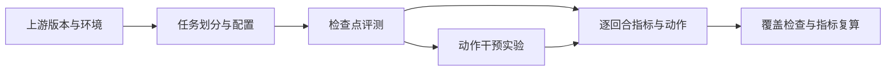

# Social Navigation · Reproduction

社会导航论文的代码复现、评测工具与控制器实验。以 **Falcon** 为起点，整理从环境配置、检查点评测到动作干预的完整实验路径。

[评测结果](#falcon-评测) · [复现进度](#复现进度) · [代码入口](#代码入口) · [阅读笔记](https://github.com/liyuqin606-del/social-navigation-reading-notes)

## Falcon 评测



**174 回合评测设置：** 官方检查点，9 个非随机选取的场景，seed 100，4 个并行环境，随机动作采样，单回合最多 500 步。图中指标由逐回合记录重算。

| 指标 | 数值 | 含义 |
|---|---:|---|
| SR ↑ | 55.75% | 成功到达目标的回合比例 |
| SPL ↑ | 50.89% | 按路径效率加权的成功率 |
| PSC ↑ | 89.44% | 个人空间合规比例，逐回合计算后平均 |
| H-Coll ↓ | 40.80% | 发生行人碰撞的回合比例 |

完整验证集为 **1,087 回合 / 56 场景**，目前已验证 **471 回合 / 24 场景**。174 回合子集与这批分片存在重叠，分别报告。分片评测使用 8 个环境，重新分组会改变随机流。

[174 回合记录](evidence/subset174/) · [471 回合覆盖](evidence/accepted471/COVERAGE.json) · [详细结果](baselines/results/falcon_subset174_20261103.md)

## 复现进度

| 工作 | 核心方法 | 当前进展 | 下一步 |
|---|---|---|---|
| **Falcon** | 未来预测辅助的社会导航策略 | 官方检查点评测；471 / 1,087 回合通过验证 | 完成剩余 616 回合 |
| **NavThinker** | 动作条件未来特征预测 | 导入兼容性与合成前向诊断 | 补齐检查点，解决 RSSM 接口差异 |
| **DPed-VLN / DPet** | 动态行人环境中的语言导航 | 数据与公开实现核查 | 接入完整作者基线 |
| **Social-WM** | 社会导航世界模型 | 论文与公开材料梳理 | 获取官方实现及训练资源 |

评测与开发记录更新至 **2026-11-08**，当前暂停运行。各项目依赖核查日期见[状态记录](baselines/REPRODUCTION_STATUS.json)。

## 代码入口



| 目录 | 内容 |
|---|---|
| [`baselines/scripts/`](baselines/scripts/) | 评测准备、分片、结果收集与独立校验 |
| [`baselines/lifecycle/`](baselines/lifecycle/) | 作业提交、监控与资源回收 |
| [`baselines/audits/`](baselines/audits/) | 环境、接口、评测协议及故障分析 |
| [`evidence/`](evidence/) | 逐回合指标、动作、配置与验证结果 |
| [`weightlab/`](weightlab/README.md) | 权重编辑、前向诊断与补丁回放 |
| [`eventnav/`](eventnav/README.md) | 事件驱动导航与相对运动原型 |
| [`research/`](research/) | 时序决策、停时算子和 Falcon 控制器实验 |

### 验证结果快照

仅需 Python 标准库：

```bash
git clone https://github.com/liyuqin606-del/social-navigation-reproduction.git
cd social-navigation-reproduction
python3 tools/verify_snapshot.py
```

脚本检查来源文件的 SHA-256、回合唯一性、场景覆盖，并重算 174 子集及 471 回合分片的聚合指标。

运行模型前，按 [UPSTREAM.json](UPSTREAM.json) 获取固定版本的源码，参考[环境记录](baselines/prep/environment_evidence.json) 安装依赖，并自行准备场景数据与检查点。运行脚本保留原环境路径，迁移时需调整路径和作业配置。

## 控制器实验

在 Falcon 策略之外探索短时避让、事件触发与运动残差。以下为 4 个开发案例上的配对实验。

| 实验 | 完整轨迹 | 总步数 | 碰撞案例救回数 |
|---|---:|---:|---:|
| 短动作干预 | 20 | 2,787 | 0 / 3 |
| 观测驱动控制器 A | 20 | 3,113 | 0 / 3 |

控制器 A 的 `yield24`、`yield_clear` 和 `sidestep` 均保持 1 / 4 成功，与基线相同。控制器 B 与运动残差实现处于本地原型阶段。

[短动作实验](evidence/experiments/headroom.json) · [控制器 A](evidence/experiments/closedloop_a.json) · [回收记录](evidence/experiments/28439_recovery.json)

## 来源与文件校验

源码版本见 [UPSTREAM.json](UPSTREAM.json)，许可与署名见 [NOTICE.md](NOTICE.md)。场景数据、模型权重和运行时由各上游项目提供；本仓库收录代码、配置与评测记录。

[EXPORT_PROVENANCE.json](EXPORT_PROVENANCE.json) 记录原始导出文件的来源及哈希；[SHA256SUMS](SHA256SUMS) 校验当前仓库快照。指标图可通过 `python3 tools/render_results.py` 重新生成。
