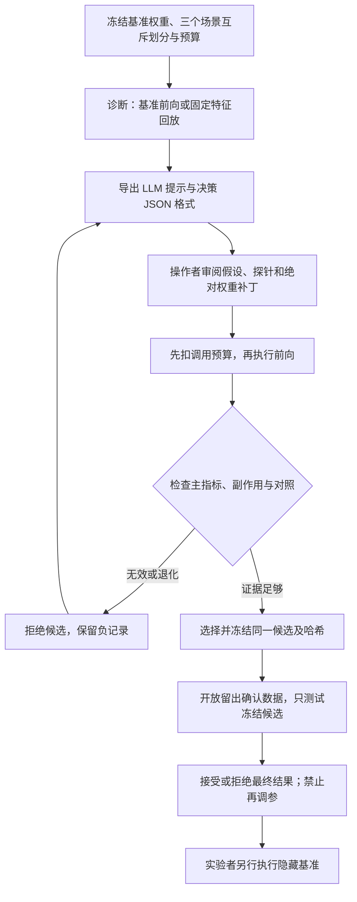

# Weightlab：可审计的导航权重编辑工作台

这套工作台将“诊断 → 提出补丁 → 前向反馈 → 修订或回退 → 冻结 → 留出确认”接到真实 Falcon 动作头上。目前可运行的是 **由操作者驱动的 CPU 动作头回放闭环**：使用实际导出的权重、固定隐藏状态和逐次预算账本。CLI 不会自动调用 LLM、申请 GPU 或执行任意修改代码。完整策略闭环评测必须另外接入已经审阅的托管作业入口。



## 已实现的接口与边界

| 部件 | 提供什么 | 不代表什么 |
|---|---|---|
| `session.py` | 不可覆盖的候选、预算预留、场景互斥、证据哈希、冻结与确认门禁 | 不独立证明外部程序真的执行了模型 |
| `falcon_checkpoint.py` | 从固定 SHA256 的官方检查点导出允许编辑的 float32 张量 | 未训练、未前向运行完整策略 |
| `replay.py` + CLI | 对同一批固定隐藏状态计算基准/候选动作头输出、KL 和可选标签一致率 | 没有 Habitat 回合、SR/SPL/碰撞率或世界模型训练 |
| `agent-prompt` | 给外部 LLM 的经过筛选的状态、规则和单个决策 JSON schema | 不调用模型；不提供自动修复算法或对外部代理的 OS 隔离 |
| `code` | 当前拒绝执行，直到代码沙箱通过独立验收 | 不能将未验收的 `code_runner.py` 当作可用安全执行器 |
| `examples/weightlab/synthetic_demo.py` | 实际 Falcon 动作头 + 明确标注的合成隐藏状态，演示回退、冻结、确认 | 不是科学实验，不提供导航提升证据 |

Falcon 的动作头为 `action_distribution.linear.weight[4,512]` 和 `bias[4]`，共 2052 个参数。补丁 NPZ 装的是 **替换后的绝对张量**。未提供的可编辑张量继承所指定的 `parent`，默认是不可变的 `base`。选择 `base` 也是合法结论；没有必要为了交付而保留无效补丁。拒绝候选不会删除负结果。

动作语义维持官方映射：0 是 STOP，1 是前进，2/3 是左右转；不能把 STOP 解释成 WAIT。固定特征上的线性头修改不涵盖闭环中变化的观测、LSTM 状态和随机动作流。

## 输入准备

在项目根目录 `/Users/yuqinli/Documents/ChatGPT/VLN` 使用 `.venv/bin/python`。`examples/weightlab/config.template.json` 是路径占位模板，不能直接作为真实实验配置运行。

配置必须提供已核实的检查点 SHA256、基准 NPZ、精确可编辑键和三份互不共享场景的清单。清单格式为：

```json
{"role":"diagnosis","records":[{"scene_id":"development-scene-a","episode_id":"17"}]}
```

`selection`、`confirmation` 分别采用自己的角色标签和场景。三个角色都属于开发协议；**不要把正在复现的官方 1087 条验证集用来筛选补丁**，也不要把正式隐藏测试清单放入编辑会话。当前项目尚未完成可用于真实编辑的独立开发场景和隐藏状态采集，因此合成演示不能替代这些材料。

回放 NPZ 必需数组：

| 数组 | 类型与形状 |
|---|---|
| `hidden` | float32，`[N,512]` |
| `scene_ids` / `episode_ids` | 字符串数组，`[N]`，禁用 object/pickle |
| `split` | 字符串标量或 `[N]`，必须全部匹配请求角色 |
| `step_ids`（建议提供） | 非负整数 `[N]`，同一场景/回合/步不得重复 |
| `base_logits`（建议提供） | float32 `[N,4]`，由回放核对与基准头一致 |
| `actions` / `target_actions`（可选） | 整数 `[N]`，范围 0–3；标签一致率不是导航成功率 |

默认每次最多 **8 个不同回合、4096 行状态**。后者计作本次 `transition_steps`，是回放行数，不能误报为执行了 4096 个环境步。重复时间步不是独立统计样本。

## 操作者闭环

下列 `SESSION`、`CONFIG` 和 NPZ 路径须由操作者替换为自己的绝对路径。CLI 也接受相对于当前目录的路径；配置文件内的路径相对于配置所在目录解析。

```sh
.venv/bin/python -m weightlab init --session SESSION --config CONFIG
.venv/bin/python -m weightlab inspect --session SESSION --candidate base
.venv/bin/python -m weightlab replay --session SESSION --candidate base --split diagnosis --batch DIAGNOSIS.npz
.venv/bin/python -m weightlab agent-prompt --session SESSION
```

将导出的 JSON 交给外部 LLM。它返回一个决策，例如：

```json
{
  "action": "propose_patch",
  "candidate": "hypothesis_01",
  "parent": "base",
  "reason": "明确写出失败模式、可检验假设、预期副作用与对照",
  "proposal_code": "仅供操作者审阅的补丁代码文本；此 CLI 不自动执行"
}
```

操作者审阅补丁来源和约束后，生成绝对张量 NPZ，通过会话入口提交。不得在会话外偷偷进行模型试验或迭代拟合，再把结果写成一次前向发现。

```sh
.venv/bin/python -m weightlab submit --session SESSION --name hypothesis_01 --parent base --npz PATCH.npz --rationale '可检验的故障假设'
.venv/bin/python -m weightlab replay --session SESSION --candidate hypothesis_01 --split selection --batch SELECTION.npz
.venv/bin/python -m weightlab reject --session SESSION --candidate hypothesis_01 --reason '对照不支持或副作用超限'
```

对保留候选执行选择、冻结和一次留出确认：

```sh
.venv/bin/python -m weightlab select --session SESSION --candidate retained_candidate
.venv/bin/python -m weightlab freeze --session SESSION --candidate retained_candidate
.venv/bin/python -m weightlab replay --session SESSION --candidate retained_candidate --split confirmation --batch CONFIRMATION.npz
.venv/bin/python -m weightlab status --session SESSION
```

`CONFIRMED` 只表示冻结候选的确认调用已完成，**不表示达到某个效能阈值**。操作者仍须按预先规定的标准判断证据；可用 `reject` 拒绝冻结结果，会话进入 `DECLINED`，不能退回编辑状态。这个状态区别同样适用于合成演示。

正式测试由实验者从 `frozen/effective.npz` 和 `frozen/manifest.json` 另行接入完整模型并核验哈希。当前 CLI 没有隐藏测试入口，也没有“自动跑完整 Falcon 基准”的承诺。

## 预算、回退和故障恢复

默认总共 50 次前向类工具调用，包含诊断、回放、激活探针与确认；一次请求可含一批样本。对同一批状态同时计算基准和候选，计为一次配对调用，并在反馈中另外记录两个批量动作头计算。它不是“50 道题”，也不是“50 次矩阵乘法”。

会话先写入持久化预留和预算扣减，再执行模型计算。无效划分或超出样本上限的预检会在预留之前拒绝；一旦预留，失败与未知执行都不退款。默认还有 50 个候选、300 次代码运行上限和 1 次确认上限；其中 **代码执行当前未启用**，不能把配置上限当作代码执行功能已验收。

中断后使用同一会话路径读取 `status`。未结算的预留不会自动重跑。如果操作者已经查清故障，可记录失败或未知状态：

```sh
.venv/bin/python -m weightlab resolve-call --session SESSION --call-id CALL_ID --outcome unknown --reason '原执行是否完成无法确定；保留预算扣减'
```

此命令不能伪造 `completed`。未知调用没有查清前，不应安排可能重复的 GPU 作业。源码、配置、候选或证据被修改后，哈希校验会拒绝继续；应保留原会话并建立明确的新协议，不应手工改账本绕过检查。所有 `weightlab/*.py` 在创建会话时冻结，因此开发期间不要创建打算继续使用的正式会话。

CLI 和演示至少保留 4 GiB 本机余量。底层 Session API 为离线测试允许更低余量，不构成真实远端实验的授权或资源规则豁免。

## 合成演示与测试

```sh
.venv/bin/python examples/weightlab/synthetic_demo.py --output /ABS/NEW/weightlab_demo
.venv/bin/python -m unittest discover -s tests -p 'test_weightlab_cli.py' -v
```

演示默认读取 `baselines/prep/weightlab_falcon_base.npz` 及其来源 sidecar，检查官方 checkpoint SHA、导出文件 SHA 和原始张量 SHA。随后创建三个虚构场景、随机隐藏状态、两个预先指定的微小补丁：基准诊断 1 次、候选选择回放 2 次、冻结后的确认 1 次，共 **4 次回放调用、0 个导航回合、0 次 LLM 调用**。预先指定的保留/拒绝分支只是工程检查，不是根据真实任务反馈找到的优化策略。

CLI 测试还覆盖预留先于前向、失败扣费、重启预算不重置、冻结后拒绝修改、留出数据门禁、批次快照、证据篡改和未知调用结算。真实 GPU 模型、远程生命周期、代码隔离和科研指标须各自验收，不能由这些 CPU 检查替代。

## 与参考 Qwen 实验的差异

参考的是公开的 [工具与评测说明](https://github.com/RikiyaT/lm_understand-logs/blob/main/exp8_math/README.md) 和 [p50c 最终报告](https://github.com/RikiyaT/lm_understand-logs/blob/main/exp8_math/runs/p50c/work_notes/final_report.md)。公开材料不足以直接复用其完整私有 harness；这里是导航场景的独立实现。

- Qwen 原实验禁止编辑输出头；这里刻意开放 Falcon 动作头，便于小预算验证。因此不是原协议的逐项复制。
- 原实验失败请求不计预算；这里采取保守的预留后失败也扣费协议。
- 原实验的 LLM 会编写并运行受限 Python；当前 CLI 导出提示和提案格式，由操作者执行审核后的动作，任意代码入口保持关闭。
- 禁止梯度、优化器和迭代拟合是实验协议。会话哈希与调用账本无法证明操作者没有在别处运行计算，提示词也不能提供这种保证。
- 固定特征上的动作头回放只适合诊断。正式结论还需要独立开发场景、完整模型闭环、同预算随机/偏置对照、冻结后的留出验证与实验者隔离测试。
